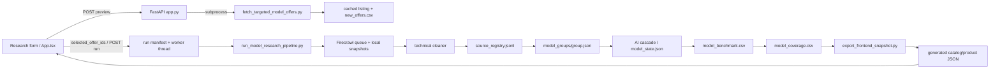

# FIELDNOTE Full Audit

**Data audytu:** 15.07.2026  
**Tryb:** lokalny, read-only, bez nowych pobrań i bez płatnych wywołań AI  
**Ocena ogólna:** **56/100**

## 1. Executive summary

FIELDNOTE ma działający szkielet lokalnego produktu: uruchamia frontend i API, pokazuje katalog 14 modeli, otwiera szczegóły, prezentuje snapshoty i provenance, wykonuje lokalny preview oraz potrafi przeprowadzić kaskadowy pipeline. Pięć modeli ma obecnie finalny stan, benchmark i coverage.

Nie jest jednak bezpieczne dalsze skalowanie systemu przed naprawami. Najpoważniejsze blokery to brak jednego źródła prawdy statusu produktu, brak blokad i transakcyjnych zapisów przy równoległych runach, brak recovery po restarcie API oraz semantyczne błędy w finalnych danych. Wszystkie 14 rekordów katalogu ma nieaktualny status, a porównanie benchmarkowe używa jednej domyślnej kategorii nawet dla nieporównywalnych wózków.

Rekomendacja: **najpierw naprawa, potem rozbudowa**. Nie przepisywać aplikacji od zera. Wprowadzić ewolucyjnie koordynator runów, kanoniczny stan produktu, atomowe zapisy i quality gate finalnych pól. Dopiero potem dokładać Amazon i kolejne marketplace'y.

## 2. Ocena

| Obszar | Ocena | Komentarz |
|---|---:|---|
| Uruchamianie lokalne | 75/100 | Start i healthcheck działają; reload i ownership portów są ryzykowne |
| Frontend i UX | 62/100 | Główne widoki działają, ale statusy i mocki wprowadzają w błąd |
| API | 65/100 | Bogate funkcjonalnie, lecz monolityczne, bez timeoutów subprocess i recovery |
| Pipeline | 58/100 | Działa przyrostowo i rozpoznaje partial/failed, ale nie jest transakcyjny |
| Jakość danych | 42/100 | 5 wyników, lecz wykryto błędy semantyczne i złą taksonomię |
| Provenance | 64/100 | Pełne dla wielu pól, ale 8 evidence items nie ma source_id |
| Testy | 40/100 | Dużo checkerów ad hoc, brak standardowego suite/CI |
| Gotowość do skalowania | 30/100 | Brak locków, paginacji i adapter contract |

Macierz obejmuje 71 funkcji: 29 `WORKING`, 26 `PARTIALLY_WORKING`, 9 `BROKEN`, 4 `MOCK_ONLY`, 3 `NOT_IMPLEMENTED`.

## 3. Mapa architektury

### Główne elementy

- Frontend: `fieldnote-frontend/src/main.tsx`, niemal cała logika UI w `fieldnote-frontend/src/app/App.tsx`.
- Backend: `fieldnote-api/app.py`, FastAPI, odczyt plików, domena i uruchamianie procesów w jednym module.
- Pipeline: `scripts/run_model_research_pipeline.py` oraz skrypty etapów w `scripts/`.
- Katalog: `data/catalog/*.json`.
- Kolejka: `output/firecrawl_offer_queue.csv`.
- Snapshoty: `input/firecrawl_offer_pages/` i `input/manufacturer_sources/`.
- Registry: `output/source_registry.jsonl`.
- Grupy i stan: `output/model_groups/<brand__model>/`.
- Wyniki zbiorcze: `output/model_benchmark.csv`, `output/model_coverage.csv`.
- Snapshot UI: `fieldnote-frontend/src/data/generated/`.
- Historia: konkurencyjnie `fieldnote-api/runs/`, `output/research_runs/` i `model_groups/*/history/`.

### Kontrakty i punkty awarii

| Przejście | Plik/funkcja | Wejście | Wyjście/zapis | Główne ryzyko |
|---|---|---|---|---|
| Formularz → preview | `fieldnote-api/app.py`, preview endpoint | marka, model, marketplace | JSON ofert + cache targeted search | cache/file shared state, classifier gaps |
| Wybór → run | `app.py`, run endpoint | selected offer IDs | `fieldnote-api/runs/<id>.json` | brak idempotencji i locka produktu |
| Run → pipeline | `pipeline_worker()` | subprocess args | stdout/stderr + run JSON | brak timeoutu, daemon thread ginie po restarcie |
| Fetch → snapshot | `fetch_firecrawl_offer_pages.py` | queue rows | raw/html/markdown/metadata | bundle zapisywany nieatomowo |
| Snapshot → clean | `clean_offer_pages_technical.py` | raw bundle | technical files | częściowy bundle po przerwaniu |
| Clean → registry | `build_source_registry.py` | offer IDs | JSONL registry | 7 rekordów bez assignment; registry samo zapisuje się atomowo |
| Registry → group | `build_model_groups.py` | group_key | group.json | cap i nieprzypisane źródła, direct write |
| Group → AI state | `extract_model_facts_cascade.py` | source snapshots | model_state.json | błędne evidence, brak transakcji |
| State → benchmark | `build_model_benchmark.py` | model states | CSV | zła kategoria i globalny race |
| Benchmark → coverage | `report_model_coverage.py` | states/benchmark | CSV/JSON | dziedziczy błędy pól |
| Wyniki → frontend | `export_frontend_snapshot.py` | katalog/states/registry | generated JSON | statyczny import wymaga rebuild poza dev HMR |

## 4. Źródła prawdy

| Pojęcie | Obecne pliki | Ocena |
|---|---|---|
| Tożsamość produktu | `data/catalog/products.json`, `group.json` | Stabilne slugi/group_key, ale status w katalogu jest stary |
| Status produktu | `products.json`, `product_analysis_status.json`, generated `catalog.json`, ostatni run | **Konkurujące źródła prawdy** |
| Finalne dane | `model_state.json`, `model_benchmark.csv`, generated product JSON | `model_state.json` powinien być kanoniczny, CSV/JSON pochodne |
| Coverage | `model_coverage.csv`, generated catalog | CSV jest raportem pochodnym, nie stanem domenowym |
| Źródła | `source_registry.jsonl`, `group.json`, queue, run manifests | Semantyka selected/fetched/attached jest rozproszona |
| Historia | `fieldnote-api/runs`, `output/research_runs`, group history | **Trzy niepełne historie** |
| Status runu | `fieldnote-api/runs/<run_id>.json` i output manifests | API UI nie korzysta ze wszystkich manifestów |

### Zalecana kanoniczna reguła statusu

Status produktu nie może kopiować statusu ostatniego runu.

1. `ready`: istnieje zwalidowany `model_state`, benchmark i snapshot frontendowy; ostatni failed run jest osobnym ostrzeżeniem.
2. `analysis_running`: aktywny, ważny lease runu dla produktu; poprzedni wynik nadal jest dostępny.
3. `analysis_failed`: brak wcześniejszego prawidłowego wyniku i ostatnia analiza zakończyła się błędem.
4. `refresh_recommended`: prawidłowy wynik istnieje, ale źródła są stare/niepełne lub coverage nie spełnia polityki.
5. Brak źródeł i nieprzeanalizowane snapshoty powinny być przyczynami/stanami operacyjnymi, nie publicznymi statusami produktu.

Stan powinien mieć osobne pola: `result_status`, `active_run_status`, `last_successful_run_id`, `last_failed_run_id`, `refresh_reason`.

## 5. Co działa stabilnie

- Stałe porty, healthcheck i uruchomienie lokalne.
- Katalog 14 unikalnych modeli, routing i odświeżenie bez utraty strony.
- Bezpieczny lokalny preview bez zewnętrznych pobrań.
- Deduplikacja targeted search po `offer_id` i rozróżnienie modelowych tokenów.
- Status fetchera `success/partial/failed` z licznikami bieżącego uruchomienia.
- Przyrostowy cleaner, registry i grupowanie po wskazanym modelu.
- Endpointy produktu, źródeł, benchmarku, historii, snapshotu i wkładu.
- 40 raw i 40 clean snapshotów; brak rzeczywistych snapshotów bez registry.
- Registry ma 41 unikalnych `source_id`, bez duplikatów.
- ORFEO rozlicza wszystkie 10 wybranych ofert: 8 fetched, 2 failed.
- Link i snapshot pozostają audytowalne po niedostępności aukcji.
- API health nie ujawnia sekretów; CORS i path resolution są lokalnie ograniczone.

## 6. Co działa częściowo

- 5 modeli ma finalne wyniki, ale ich jakość nie jest wystarczająco chroniona quality gate'em.
- Statusy UI są wyliczane sensowniej niż status katalogu, ale nie mają jednego kontraktu.
- Provenance jest kompletne dla wielu pól, lecz 8 dowodów to tekst bez `source_id`.
- Konflikty są prezentowane, ale nie wszystkie konflikty evidence są wykryte.
- Contribution endpoint działa, jednak pierwsze źródło zależy od kolejności tablicy, nie chronologii.
- Manufacturer source działa dla NEBO, lecz brak dojrzałego adapter contract i polityki niezależności treści.
- Research klasyfikuje większość ofert, lecz słownik akcesoriów jest niepełny (`materac`).
- Historia istnieje w plikach, lecz jest rozbita na trzy miejsca i niepełna dla części modeli.
- Build Vite przechodzi, ale nie uruchamia kontroli TypeScript.

## 7. Co jest zepsute

1. **Status produktu:** 14/14 wpisów katalogu ma status niezgodny z aktualnym stanem UI.
2. **Taksonomia benchmarku:** wszystkie produkty są `Spacerówki lekkie`; MOOV nie jest porównywalny w tej grupie.
3. **Równoległe runy:** brak locków; wspólne pliki i globalne raporty mogą się nadpisać.
4. **Recovery:** aktywny daemon thread znika po restarcie API, a run może pozostać `running`.
5. **Timeout procesu:** subprocess może wisieć bez końca.
6. **Atomowość:** cleaner bundle, group, state, benchmark i coverage mogą zostać zapisane częściowo.
7. **Liczniki UI:** APINO/ESME bez analizy pokazują zero braków.
8. **TypeScript:** `npm run typecheck` zgłasza 3 błędy, mimo że build przechodzi.
9. **Repo hygiene:** 990 MB, nieignorowane `.venv`, `node_modules`, pycache i ZIP-y.

## 8. Mocki i atrapy

- `Uruchomienia` używają statycznej tablicy `RUNS` w `App.tsx`, a nie rzeczywistych manifestów.
- Retry na tym ekranie jest timerem, nie wywołaniem API.
- `Integracje` pokazują fikcyjne maskowane klucze, statusy i liczniki oraz pozorny zapis.
- Profil `Jan Kowalski / Pro Workspace`, wsparcie i wersja `v0.9.1-beta` są hardcoded.

Te ekrany powinny być wyraźnie oznaczone jako demo albo wyłączone do czasu podłączenia. Obecnie podważają wiarygodność reszty aplikacji.

## 9. Problemy danych

- ORFEO: `Rama=czarna` opisuje kolor, nie materiał; evidence zawiera także Taupe, ale status nie jest conflicting.
- ORFEO: Marka została potwierdzona evidence zawierającym brak bezpośredniego potwierdzenia.
- ORFEO: Akcesoria mieszają elementy zestawu z opcjonalnymi zakupami.
- NEBO: `Siedzisko` ma konflikt oparty na evidence mówiącym, że brak szczegółowych informacji.
- MOOV: `Składanie jedną ręką` wynika z ogólnej informacji o możliwości złożenia.
- SIESTA 2: run `success`, ale brak final state/benchmark/coverage.
- TRIG 3: finalny wynik istnieje, ale brak kompletnej historii i assignment dla części źródeł.
- 7 rekordów registry nie ma `product_id/group_key`; 5 wygląda na poprawne kandydaty TRIG 3.
- 8 dowodów w finalnych produktach ma excerpt bez source_id.
- `content_family_id` nie gwarantuje, że kopie opisu nie zostaną policzone jako niezależne potwierdzenia.

Pełne rekordy wszystkich produktów znajdują się w `FIELDNOTE_DATA_AUDIT.json`.

## 10. Problemy UX

- Katalog pokazuje `Braki: 0` dla produktów nieprzeanalizowanych.
- Publiczne statusy nie odpowiadają stanowi katalogu i historii.
- Ekrany mock wyglądają jak produkcyjne.
- Widoczny przycisk zamknięcia sidebara na desktopie jest martwy.
- Użytkownik nie widzi jasno różnicy między wybraną, pobraną, zarejestrowaną i użytą liczbą źródeł.
- Coverage wygląda jak ocena jakości, choć mierzy głównie pokrycie i dziedziczy błędy walidacji.
- Konsola przeglądarki ma 404 dla favicon; brak crashy w głównych trasach.

## 11. Problemy pipeline'u i architektury

- `fieldnote-api/app.py` ma ok. 1971 linii i miesza endpointy, domenę, parsowanie plików, subprocess i worker.
- `App.tsx` ma ok. 2037 linii i miesza routing, API, stan, widoki oraz dane demonstracyjne.
- Brak centralnych modeli `ProductStatus`, `RunStatus`, `SourceRole` i wersjonowanych kontraktów API.
- `filter_selected_offers()` przepisuje wspólny `new_offers.csv`, co jest wyścigiem między runami.
- Benchmark/coverage są globalnie przebudowywane podczas runu jednego modelu.
- Brak per-product lock i global aggregation lock.
- Brak timeout/cancel i trwałego workera.
- Część zapisów jest atomowa, ale najważniejsze state/group/result nie są.
- Statyczne importy generated JSON oznaczają, że produkcyjny frontend wymaga przebudowy po eksporcie.

Nie ma krytycznego powodu do rewrite. Należy najpierw wydzielić małe serwisy/repositories wokół istniejących formatów.

## 12. Bezpieczeństwo i niezawodność

### Dobre praktyki potwierdzone

- API i frontend nasłuchują na `127.0.0.1`.
- CORS ograniczony do lokalnego Vite.
- `.env` ma uprawnienia `0600` i jest ignorowany.
- Health zwraca tylko booleany konfiguracji kluczy.
- Subprocess jest budowany jako lista argumentów, bez `shell=True`.
- Snapshot path jest rozwiązywany pod katalogiem projektu.
- Skan plików poza `.env` nie wykrył sekretów.

### Ryzyka

- Brak locków i nieatomowe zapisy stanowią realne ryzyko utraty/spójności danych.
- Brak timeoutów subprocess pozwala na nieskończone runy.
- Uvicorn `--reload` może przerwać pracę wątku.
- Start/stop może zabić obcy proces na zarezerwowanym porcie.
- API bez autoryzacji jest dopuszczalne wyłącznie lokalnie; nie nadaje się do ekspozycji sieciowej.
- Brak paginacji i limitów wielkości evidence utrudni Amazon/multi-market.
- `.gitignore` nie obejmuje większości artefaktów; repo nie jest obecnie wykrywane jako git checkout.

## 13. Testy end-to-end

| Test | Wynik | Dowód |
|---|---|---|
| 1. Gotowy produkt | PASS | ORFEO i NEBO otwarte w Chrome; pola i zakładki renderują się |
| 2. Failed + wcześniejszy wynik | PARTIAL | ESME ma success+failed, ale brak final state; status dominuje latest failure |
| 3. Źródła ORFEO | PASS | API 200, 10 ofert rozliczonych |
| 4. Raw/clean snapshot | PASS | API snapshot 200; technical clean 4248 znaków |
| 5. Wkład z polami | PASS | 11 nowych, 1 konflikt, 11 finalnie użytych dla testowego source |
| 6. Zerowy wkład | PASS | Czytelny komunikat, brak pustego panelu |
| 7. Benchmark | PASS techniczny / FAIL domenowy | 5 modeli renderowanych; błędna wspólna kategoria |
| 8. Historia | PARTIAL | Endpoint działa, ale historia jest rozproszona i niepełna |
| 9. Local preview | PASS | NEBO 20 ofert z cache, zero wywołań sieciowych |
| 10. start/status/stop/start | PASS z ryzykiem | oba serwisy HTTP 200; ownership portów zbyt szeroki |

Test interakcji przeglądarkowej obejmował katalog → ORFEO → benchmark → back → sources → contribution → reload. Jedyny błąd konsoli to brak `favicon.ico`.

Zrzuty diagnostyczne: `/tmp/fieldnote-products.png`, `/tmp/fieldnote-orfeo.png`, `/tmp/fieldnote-sources.png`, `/tmp/fieldnote-research.png`, `/tmp/fieldnote-runs.png`, `/tmp/fieldnote-integrations.png`.

Kontrola danych krytycznych objęła 78 plików; ich hashe nie zmieniły się podczas audytu.

## 14. Jakość kodu i testy

- `npm run build`: PASS, 1614 modułów, JS ok. 410 kB, CSS ok. 100 kB.
- `npm run typecheck`: FAIL, 3 błędy w `App.tsx`.
- 11 głównych skryptów Python przechodzi parsowanie AST.
- `check_product_sources.py`, `check_targeted_model_fetcher.py`, `check_research_state_isolation.py`, `check_cascade_field_validation.py`: PASS.
- Brak pytest/vitest/Jest i automatycznego zestawu CI.
- Istnieje 33 niezależnych `check_*.py`; przydatne, lecz nie tworzą spójnej piramidy testów.
- Brak centralnego repozytorium danych i migracji schematu.
- Nazewnictwo `selected`, `fetched`, `attached`, `registry`, `group sources`, `used` wymaga formalnego słownika.

## 15. Gotowość do rozbudowy

| Kierunek | Ocena | Warunki |
|---|---|---|
| Oficjalne strony producentów | READY_AFTER_FIXES | Kanoniczny source adapter, authority/content-family policy, locki, quality gate; podstawowy NEBO już działa |
| Amazon | NOT_READY | Najpierw statusy, transakcje, source contracts, paginacja, rate limit, taksonomia i testy classifiera |
| Kolejny marketplace | READY_AFTER_FIXES | Adapter interface, wspólna normalizacja offer/source ID, role i provenance |
| Automatyczne refreshe | NOT_READY | Trwały scheduler/worker, leases, idempotencja, timeout/cancel, version history |
| Wielu użytkowników | NOT_READY | Auth, izolacja danych, DB/locking, kolejka zadań, audyt uprawnień |
| Wdrożenie poza komputer lokalny | NOT_READY | Auth, secret manager, trwały worker, storage, observability, deployment config |

## 16. Rekomendacja

Nie dodawać Amazonu ani kolejnych marketplace'ów przed zamknięciem P0 i P1. Pierwsza naprawa powinna wprowadzić **koordynator runu per produkt**: lock, immutable run context, timeout/cancel, atomowy commit wyniku i recovery. Równolegle trzeba ustanowić kanoniczny status produktu oparty na ostatnim poprawnym wyniku, a nie na ostatnim runie.

Po tych zmianach należy poprawić taksonomię i jednorazowo, bez pobierania danych, rewalidować 5 istniejących finalnych modeli. Dopiero wtedy coverage i benchmark będą wystarczająco wiarygodne, aby rozszerzać system.
