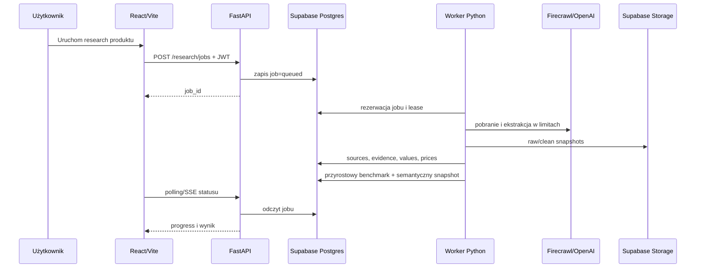

# feat: Domknij wieloużytkownikowe MVP wózków FIELDNOTE

## Przegląd

Plan przekształca działające lokalne FIELDNOTE w bezpieczną, wieloużytkownikową aplikację webową dla kategorii wózków. Zachowuje obecny pipeline Python, kontrakt adapterów, provenance, quality gate, historię runów i React/FastAPI. Zmienia magazyn danych z plików na Supabase, dodaje logowanie i role, trwałą kolejkę zadań, przyrostowe przeliczanie benchmarków oraz wdrożenie na Renderze.

Zakres kończy wszystko, co rzeczywiście istnieje już w projekcie: 34 produkty Lionelo oraz obecny katalog realnych konkurentów. Nie rozszerza katalogu o nowe marki ani nie rozpoczyna fotelików.

## Ujęcie problemu

Lokalne MVP ma solidne fundamenty danych i offline test gate, ale nie jest gotowe do pracy kilku użytkowników ani wdrożenia poza localhost. Stan jest rozproszony pomiędzy `data/`, `input/`, `output/`, `fieldnote-api/runs/` i statycznymi snapshotami frontendu. Locki są lokalne, research zależy od procesu API, a `fieldnote-api/app.py` i `fieldnote-frontend/src/app/App.tsx` pozostają dużymi plikami historycznymi.

Plan nie przepisuje pipeline'u. Najpierw otacza istniejącą logikę trwałą bazą, workerem i kontraktami repozytoriów; refaktor następuje wyłącznie tam, gdzie jest konieczny do izolacji danych, bezpieczeństwa lub przyrostowego wykonania.

## Śledzenie wymagań

- **R1:** wieloużytkownikowa aplikacja webowa z rolami i kontami tworzonymi przez administratora.
- **R2:** 34 produkty Lionelo i obecne realne modele konkurencji jako zamknięty zakres MVP.
- **R3:** ręczny import XLSX `WÓZKI` z preview i commit.
- **R4:** jeden model produktu `marka + model + konfiguracja`, bez kolorów i zestawów promocyjnych.
- **R5:** benchmark wewnętrzny dla grup minimum 3 produktów Lionelo.
- **R6:** benchmark zewnętrzny wyłącznie w tym samym segmencie i konfiguracji.
- **R7:** wspólny lifecycle źródeł Firecrawl dla producentów, Allegro, Amazonu i sklepów branżowych.
- **R8:** surowe snapshoty w Storage oraz wartości, evidence i provenance w PostgreSQL.
- **R9:** wersjonowany schemat atrybutów wózków w repozytorium i jednorazowy audyt 21 pól.
- **R10:** ranking względny wewnątrz segmentu; cena pozostaje osobnym wymiarem.
- **R11:** kolejka PostgreSQL, dwa równoległe zadania, blokada per produkt i trwałość po zamknięciu przeglądarki.
- **R12:** research i przeliczanie przyrostowe, z osobną akcją pełnej przebudowy.
- **R13:** kontrola kosztów, timeout, retry i status `partial`.
- **R14:** mediana oraz min–max cen brutto po deduplikacji sprzedawców.
- **R15:** snapshot tylko po istotnej zmianie i audyt ręcznych korekt.
- **R16:** Supabase Auth/Postgres/Storage, Render frontend/API/worker, prywatny GitHub i CI bez płatnych API.
- **R17:** bramka bezpieczeństwa przed produkcją.
- **R18:** recenzje, social media i automatyczne wnioski AI pozostają poza MVP, ale model źródeł umożliwia ich późniejsze dodanie.

## Granice scope'u

- Tylko rynek polski i wózki.
- Brak nowych marek i modeli poza aktualnym katalogiem repozytorium.
- Brak fotelików, PIM/ERP, SSO i bezpośredniej synchronizacji Google Sheets.
- Brak automatycznego harmonogramu odświeżeń i masowego researchu jednym kliknięciem.
- Brak analizy recenzji/social mediów oraz rekomendacji strategicznych AI.
- Brak kolorów, edycji specjalnych i zestawów promocyjnych.
- Brak administracyjnego kreatora schematów kategorii.
- Brak pełnej migracji wszystkich historycznych outputów.
- Brak własnych scraperów; sieć obsługuje Firecrawl.

## Kontekst i research

### Potwierdzony stan repozytorium

- `scripts/run_model_research_pipeline.py` jest kanonicznym entrypointem pipeline'u.
- `scripts/source_adapters.py` definiuje wspólny kontrakt `SourceAdapter`; istnieją adaptery Allegro, producenta i fixtures.
- `scripts/provenance_v1.py`, `scripts/source_commit.py`, `scripts/source_lifecycle.py` i `scripts/quality_gate.py` zapewniają evidence, provenance, lifecycle i jakość danych.
- `scripts/import_lionelo_strollers.py` oraz `scripts/import_lionelo_internal_specs.py` obsługują katalog i specyfikacje Lionelo; test wymaga dokładnie 34 snapshotów.
- `data/catalog/products.json` zawiera 53 rekordy: 34 Lionelo i 19 rekordów pozostałych marek, w tym placeholder `Accessory / part`, który należy wykluczyć.
- `data/catalog/category_registry.json` ma cztery aktualne grupy wózków.
- `fieldnote-api/app.py` udostępnia produkty, źródła, evidence, historię, runy oraz benchmarki wewnętrzne i zewnętrzne.
- `fieldnote-frontend/src/app/App.tsx` ma istniejące widoki katalogu, benchmarków, źródeł, researchu i runów.
- `docs/audit/IMPLEMENTATION_STATUS.md` potwierdza działający offline gate i jawnie oznacza multi-user oraz deployment jako deferred.
- Aktualne locki i atomowe zapisy chronią pojedynczą lokalną instancję, ale nie wiele hostów.
- Repozytorium ma obszerny niezacommitowany stan. Przed migracją trzeba utworzyć bezpieczny baseline bez `input/`, `output/`, runów, środowisk i sekretów.

### Wzorce do zachowania

- Adapter źródła nie zapisuje benchmarku ani stanu produktu; commit wykonuje wspólna warstwa lifecycle.
- Awaria źródła daje `partial`, a nie fałszywy sukces.
- Evidence jest ładowane lazy i wskazuje źródło przez stabilny `source_id`.
- Produkty bez analizy mają metryki `null`, nie fałszywe zero.
- Benchmark zewnętrzny ma jawny anchor Lionelo i uczestników z tej samej grupy.
- Testy domyślnie są offline i nie wywołują Firecrawl/OpenAI.

### Źródło prawdy UI

- Bieżący React/Vite oraz `docs/UX_REDESIGN.md` są źródłem flow i komponentów.
- Nie wykonujemy pełnego redesignu podczas migracji.
- Duży `App.tsx` jest rozdzielany tylko wraz z przenoszeniem konkretnego działającego ekranu.

### Referencje zewnętrzne

- Supabase Auth wykorzystuje JWT i integruje autoryzację z RLS; publiczne profile powinny referować `auth.users`.
- Render obsługuje FastAPI jako web service i długotrwałe background workers.
- Firecrawl v2 udostępnia oddzielne endpointy Search, Scrape i Crawl, zwraca zużycie kredytów i sygnalizuje limity przez HTTP 429.
- GitHub Actions environments i secrets rozdzielają staging/production; ograniczenia planu prywatnego repozytorium należy sprawdzić podczas konfiguracji.

## Kluczowe decyzje techniczne

- **Supabase jest systemem trwałym:** PostgreSQL przechowuje stan domenowy i kolejkę, Auth użytkowników, Storage surowe snapshoty.
- **Frontend nie czyta danych bezpośrednio z plików:** po migracji korzysta wyłącznie z API; wygenerowane JSON-y pozostają fixtures/archiwum.
- **Frontend używa Supabase wyłącznie do sesji:** dane biznesowe przechodzą przez FastAPI. API weryfikuje JWT i role; worker korzysta z serwerowych poświadczeń.
- **RLS pozostaje obroną warstwową:** uwierzytelnieni użytkownicy mogą czytać cały katalog; zapisy są ograniczone rolami i serwerem.
- **Kolejka jest w PostgreSQL:** worker rezerwuje zadania leasingiem i `SKIP LOCKED`; aktywny research tego samego produktu jest unikalny.
- **Dwa sloty wykonawcze:** dwa różne produkty mogą działać równolegle, operacje globalne są serializowane.
- **Pipeline jest opakowany, nie przepisywany:** worker wywołuje istniejące etapy przez wydzielony service facade.
- **Budowanie danych jest przyrostowe:** wybrany produkt, jego źródła, benchmarki zewnętrzne i jedna grupa wewnętrzna.
- **Konfiguracja wózków jest w repo:** jeden wersjonowany plik zawiera atrybuty, aliasy, jednostki, role i wagi profili.
- **Nowy ranking nie używa `src/scoring.py`:** obecny moduł nadal ocenia dopasowanie ofert; ranking produktowy ma osobny moduł.
- **Cena nie wpływa na wynik użytkowy.**
- **Migracja jest selektywna:** importuje katalog, specyfikacje i dane z prawidłowym provenance; resztę zachowuje jako read-only archive.
- **Staging poprzedza produkcję:** produkcja nie jest wystawiana przed przejściem security gate i smoke testów.

## Docelowy przepływ

## Model danych

Minimalne grupy tabel:

- **Tożsamość i katalog:** `brands`, `products`, `product_aliases`, `product_skus`, `product_profile_overrides`.
- **Atrybuty:** `attribute_schema_versions`, `attribute_values`, `attribute_value_candidates`, `manual_overrides`.
- **Źródła:** `sources`, `product_source_links`, `source_snapshots`, `evidence_items`, `content_families`.
- **Rynek:** `sellers`, `offers`, `price_observations`, `availability_observations`.
- **Benchmarki:** `competitive_benchmarks`, `competitive_benchmark_participants`, `benchmark_results`, `benchmark_snapshots`.
- **Operacje:** `research_jobs`, `research_job_events`, `import_runs`, `audit_events`.
- **Użytkownicy:** `profiles` referujące `auth.users`, z rolą `viewer|analyst|admin` i flagą wymuszonej zmiany hasła.

Encje zachowują obecne stabilne identyfikatory `product_id`, `source_id`, `group_key`, `evidence_id` tam, gdzie są poprawne, aby ograniczyć koszt migracji.

## Otwarte pytania

### Rozwiązane podczas planowania

- **Docelowe wdrożenie:** React/FastAPI/worker na Renderze, Supabase jako Auth/Postgres/Storage.
- **Autoryzacja:** email/hasło, konta administratora, brak self-signup.
- **Zakres danych:** publiczne specyfikacje i ceny brutto.
- **Zakres katalogu:** całe 34 Lionelo oraz obecni realni konkurenci.
- **Scoring:** względny w obrębie segmentu, bez stałych progów i bez ceny.
- **Źródła:** Firecrawl dla producentów, Allegro, Amazonu i wybranych sklepów.
- **Kolejka:** PostgreSQL, dwa równoległe joby, jeden job per produkt.
- **Testy:** offline fixtures w CI; live tylko ręcznie.

### Odroczone do implementacji

- Mapowanie sześciu niezaklasyfikowanych modeli Kinderkraft do `stroller_2in1` lub `stroller_3in1` po odczycie oficjalnych kart.
- Finalny podział 21 pól po raporcie audytu atrybutów.
- Konkretny limit stron, tokenów i retry po kontrolowanych runach stagingowych.
- Retencja surowych snapshotów po pomiarze rozmiaru Storage.
- Szczegółowe reguły identyfikacji tego samego sprzedawcy przy brakujących danych firmy.
- Czy stan jobów będzie przekazywany pollingiem czy SSE; wybrać po minimalnym prototypie API, bez zmiany modelu domenowego.

## Implementation Units

### Faza 0 — bezpieczny baseline

- [ ] **Unit 1: Utworzyć bezpieczny baseline repozytorium i CI**

**Cel:** Przygotować prywatne repozytorium GitHub bez lokalnych danych, sekretów i artefaktów oraz zachować aktualny działający stan jako pierwszy audytowalny baseline.

**Wymagania:** R16, R17.

**Zależności:** Brak.

**Pliki:**
- Modyfikuj: `.gitignore`
- Stwórz: `.env.example`
- Stwórz: `fieldnote-api/.env.example`
- Stwórz: `fieldnote-frontend/.env.example`
- Stwórz: `.github/workflows/ci.yml`
- Stwórz: `.github/dependabot.yml`
- Stwórz: `docs/SECURITY_BASELINE.md`
- Modyfikuj: `scripts/check_fieldnote.sh`
- Test: `tests/test_repository_hygiene.py`

**Delegate to:** feature-builder-fullstack

**Skills in play:** tailwind-react-guidelines, ux-ui-guidelines, supabase-dev-guidelines, security, sentry-integration, figma:figma-use, figma-design-to-code

**Podejście:**
- Zbudować pierwszy commit z kodu i fixtures, bez `input/`, `output/`, wygenerowanych snapshotów, runów, `.venv`, `.pnpm-store` oraz plików `.env*`.
- Potwierdzić, że plik `fieldnote-api/.env 2` i żaden podobny plik nie trafi do repo; jeśli kiedykolwiek zawierał prawdziwy sekret, rotować klucze przed pierwszym push.
- CI wykonuje istniejącą pełną bramkę offline oraz skan sekretów i zależności.
- Nie dodawać sekretów Firecrawl/OpenAI/Supabase do GitHub Actions dopóki nie istnieje kontrolowany live workflow.

**Wzorce do naśladowania:**
- `scripts/check_fieldnote.sh`
- Obecny podział fixtures vs lokalne artefakty w `.gitignore`.

**Scenariusze testowe:**
- [Unit] Repo hygiene test odrzuca śledzone `.env`, klucze, bazy, snapshoty produkcyjne i katalogi środowisk.
- [Unit] Pełny gate działa bez sieci i kluczy API.
- [Manual] Właściciel tworzy prywatne repozytorium i wykonuje pierwszy push po przeglądzie listy plików.

**Weryfikacja:**
- `scripts/check_fieldnote.sh` przechodzi w czystym checkout bez Firecrawl/OpenAI.
- Test repo hygiene nie znajduje sekretów ani lokalnych artefaktów w indeksie Git.

**Operator checklist:**
- [ ] Utworzyć prywatne repozytorium GitHub i zweryfikować widoczność `Private`.
- [ ] Rotować każdy klucz, który mógł znaleźć się w ZIP-ie lub lokalnym pliku środowiskowym.

### Faza 1 — trwała platforma danych i użytkowników

- [ ] **Unit 2: Dodać Supabase schema, Auth, Storage i RLS**

**Cel:** Utworzyć trwały model danych, role i prywatny magazyn snapshotów bez zmiany istniejącego pipeline'u.

**Wymagania:** R1, R4, R8, R14–R18.

**Zależności:** Unit 1.

**Pliki:**
- Stwórz: `supabase/config.toml`
- Stwórz: `supabase/migrations/202607230001_core_catalog.sql`
- Stwórz: `supabase/migrations/202607230002_sources_provenance.sql`
- Stwórz: `supabase/migrations/202607230003_market_benchmarks.sql`
- Stwórz: `supabase/migrations/202607230004_jobs_audit.sql`
- Stwórz: `supabase/migrations/202607230005_auth_roles_rls_storage.sql`
- Stwórz: `supabase/seed.sql`
- Stwórz: `e2e/seeds/fieldnote-stroller-mvp-seed.sql`
- Test: `tests/test_supabase_schema_contract.py`
- Test: `tests/test_rls_policy_contract.py`

**Delegate to:** feature-builder-data

**Skills in play:** supabase-dev-guidelines, security, sentry-integration

**Podejście:**
- Zachować stabilne identyfikatory z obecnych kontraktów, dodając UUID tylko jako wewnętrzne klucze tam, gdzie jest potrzebny.
- `profiles` referuje `auth.users`; role są enumem i nie pochodzą z danych wysyłanych przez frontend.
- Wyłączyć self-signup. Użytkowników tworzy serwerowa akcja admina; `must_change_password` blokuje resztę aplikacji do zmiany hasła.
- Wszystkie tabele biznesowe mają RLS. Użytkownicy authenticated czytają całość; zapisy są ograniczone do analityka/admina, zarządzanie kontami do admina.
- Buckety `source-raw`, `source-clean` i `imports` są prywatne; klient nie otrzymuje service-role key.
- `reviews` i `social` są dozwolonymi typami źródeł, ale brak endpointów aktywujących je w MVP.

**Notatka wykonawcza:** Najpierw testy kontraktów unikalności, RLS i usuwania użytkownika; błędne polityki są ryzykiem bezpieczeństwa, nie kosmetyką.

**Wzorce do naśladowania:**
- Modele `ProductV1`, `SourceRecordV2`, `ProductSourceLinkV1`, `EvidenceItemV1`, `RunManifestV1` w `fieldnote-api/contracts.py`.
- Stabilne identyfikatory z `scripts/catalog_registry.py`, `scripts/source_lifecycle.py` i `scripts/provenance_v1.py`.

**Scenariusze testowe:**
- [Unit] Niezalogowany użytkownik nie czyta tabel ani prywatnych bucketów.
- [Unit] Odbiorca nie tworzy jobu, importu ani override'u.
- [Unit] Analityk tworzy job i override, ale nie tworzy użytkowników.
- [Unit] Administrator tworzy konto z `must_change_password=true`.
- [Unit] Unikalny aktywny job per produkt blokuje duplikat.
- [Unit] Ten sam `source_id` może łączyć się z wieloma produktami bez duplikowania źródła.

**Weryfikacja:**
- Migracje tworzą czystą bazę bez błędów.
- Testy RLS potwierdzają role viewer/analyst/admin i odmowę dla anon.
- Seed jest idempotentny.

- [ ] **Unit 3: Wprowadzić repozytoria Supabase i selektywną migrację stanu**

**Cel:** Zamienić pliki jako źródło produkcyjne na repozytoria PostgreSQL/Storage, zachowując lokalny tryb read-only do czasu porównania wyników.

**Wymagania:** R2, R8, R15, R16.

**Zależności:** Unit 2.

**Pliki:**
- Stwórz: `fieldnote-api/repositories/catalog_repository.py`
- Stwórz: `fieldnote-api/repositories/source_repository.py`
- Stwórz: `fieldnote-api/repositories/benchmark_repository.py`
- Stwórz: `fieldnote-api/repositories/job_repository.py`
- Stwórz: `fieldnote-api/repositories/audit_repository.py`
- Stwórz: `fieldnote-api/repositories/supabase_client.py`
- Modyfikuj: `fieldnote-api/repositories/snapshot_repository.py`
- Modyfikuj: `fieldnote-api/services/product_service.py`
- Modyfikuj: `fieldnote-api/services/source_service.py`
- Modyfikuj: `fieldnote-api/services/run_service.py`
- Stwórz: `scripts/migrate_validated_state_to_supabase.py`
- Stwórz: `scripts/audit_supabase_migration.py`
- Test: `tests/test_supabase_repositories.py`
- Test: `tests/test_selective_migration.py`

**Delegate to:** feature-builder-data

**Skills in play:** supabase-dev-guidelines, security, sentry-integration

**Podejście:**
- Dodać interfejsy repozytoriów pod istniejącymi services, bez jednorazowego przepisywania endpointów.
- Tryb `legacy_readonly` odczytuje obecne JSON-y tylko do porównania i awaryjnego rollbacku; żadne nowe runy nie zapisują do globalnego plikowego stanu po przełączeniu.
- Migrować 34 Lionelo, realne produkty konkurencji, istniejące aliasy/tożsamość, poprawne źródła, links, evidence i wartości z prawidłowym provenance.
- Wykluczyć placeholdery, akcesoria, uszkodzone referencje i nieprzypisane outputy; `unattributed_legacy` może zostać zapisane tylko jawnie jako legacy.
- Surowe/clean snapshoty przenosić do Storage z zachowaniem content hash; nie duplikować identycznych blobów.

**Scenariusze testowe:**
- [Unit] Migracja tworzy dokładnie 34 benchmarkowe produkty Lionelo.
- [Unit] `Accessory / part` nie trafia do aktywnego katalogu.
- [Unit] Powtórna migracja jest idempotentna.
- [Unit] Liczniki źródeł i evidence po migracji odpowiadają zatwierdzonym danym lokalnym.
- [Unit] Uszkodzony source reference trafia do raportu, nie przerywa całej migracji.

**Weryfikacja:**
- `audit_supabase_migration.py` raportuje 34 Lionelo oraz zero niejawnie utraconych poprawnych source links.
- API odczytuje katalog z Supabase bez korzystania z `fieldnote-frontend/src/data/generated`.

- [ ] **Unit 4: Dodać logowanie, role i administrację kontami**

**Cel:** Zabezpieczyć wszystkie ekrany i endpointy oraz wdrożyć konta tworzone przez administratora.

**Wymagania:** R1, R17.

**Zależności:** Unit 2 i Unit 3.

**Pliki:**
- Stwórz: `fieldnote-api/auth/dependencies.py`
- Stwórz: `fieldnote-api/auth/roles.py`
- Stwórz: `fieldnote-api/services/user_service.py`
- Stwórz: `fieldnote-api/routers/auth.py`
- Stwórz: `fieldnote-api/routers/admin_users.py`
- Modyfikuj: `fieldnote-api/app.py`
- Stwórz: `fieldnote-frontend/src/auth/supabase.ts`
- Stwórz: `fieldnote-frontend/src/auth/AuthProvider.tsx`
- Stwórz: `fieldnote-frontend/src/auth/RequireRole.tsx`
- Stwórz: `fieldnote-frontend/src/features/auth/LoginPage.tsx`
- Stwórz: `fieldnote-frontend/src/features/auth/ChangeInitialPasswordPage.tsx`
- Stwórz: `fieldnote-frontend/src/features/admin/UsersPage.tsx`
- Modyfikuj: `fieldnote-frontend/src/api/client.ts`
- Modyfikuj: `fieldnote-frontend/src/routes/navigation.ts`
- Modyfikuj: `fieldnote-frontend/src/app/App.tsx`
- Test: `tests/test_auth_roles.py`
- Test: `fieldnote-frontend/tests/auth-guards.test.mjs`

**Delegate to:** feature-builder-fullstack

**Skills in play:** tailwind-react-guidelines, ux-ui-guidelines, supabase-dev-guidelines, security, sentry-integration, figma:figma-use, figma-design-to-code

**Podejście:**
- Frontend przechowuje sesję przez oficjalny klient Supabase; każdy request FastAPI otrzymuje bearer token.
- API weryfikuje JWT i profil roli przed handlerem; nie ufa roli przesłanej przez klienta.
- Administrator tworzy użytkownika przez serwerową metodę Auth Admin, ustawia rolę i jednorazowe hasło.
- Użytkownik z `must_change_password` widzi wyłącznie ekran zmiany hasła i wylogowania.
- Publiczne `/api/health` pozostaje ograniczone do minimalnego statusu; reszta API wymaga auth.

**Scenariusze testowe:**
- [Unit] Brak tokenu daje 401, brak roli daje 403.
- [Unit] Viewer może czytać produkty, ale nie uruchamia researchu.
- [Unit] Analyst nie ma dostępu do tworzenia użytkowników.
- [E2E] Logowanie użytkownika z hasłem tymczasowym prowadzi do obowiązkowej zmiany hasła, a potem do katalogu.
- [E2E] Viewer nie widzi akcji importu i researchu.

**Weryfikacja:**
- Testy backendu i frontendu potwierdzają pełną macierz ról.
- Agent-browser przechodzi flow logowania, wymuszonej zmiany hasła i blokady viewer.

### Faza 2 — trwały research i obecny pipeline

- [ ] **Unit 5: Zbudować trwałą kolejkę PostgreSQL i worker z dwoma slotami**

**Cel:** Research ma działać niezależnie od sesji przeglądarki, zachować postęp i nie uruchamiać dwóch jobów tego samego produktu.

**Wymagania:** R11, R13, R15.

**Zależności:** Unit 3 i Unit 4.

**Pliki:**
- Stwórz: `fieldnote-api/services/job_service.py`
- Stwórz: `fieldnote-api/services/pipeline_service.py`
- Stwórz: `fieldnote-api/routers/jobs.py`
- Stwórz: `fieldnote-api/worker.py`
- Modyfikuj: `fieldnote-api/run_coordinator.py`
- Modyfikuj: `fieldnote-api/app.py`
- Modyfikuj: `scripts/run_context.py`
- Modyfikuj: `scripts/run_manifest.py`
- Modyfikuj: `scripts/run_model_research_pipeline.py`
- Test: `tests/test_postgres_job_queue.py`
- Test: `tests/test_worker_leases.py`
- Test: `tests/test_job_cost_limits.py`
- Test: `fieldnote-frontend/tests/run-status.test.mjs`

**Delegate to:** feature-builder-data

**Skills in play:** supabase-dev-guidelines, security, sentry-integration

**Podejście:**
- API zapisuje job i natychmiast zwraca `job_id`; nie uruchamia subprocessu w request thread.
- Worker rezerwuje job przez transakcję, `FOR UPDATE SKIP LOCKED` i lease; heartbeat przedłuża lease.
- Jedna instancja workera obsługuje dwa sloty lub dwa identyczne worker processes; ograniczenie jest wymuszane również w bazie, nie tylko w pamięci.
- Status i eventy przechodzą do PostgreSQL; lokalne manifesty mogą pozostać artefaktem diagnostycznym, ale nie źródłem prawdy.
- Limity stron, tokenów, timeout i retry są częścią job payload oraz finalnego usage summary.
- Przekroczenie budżetu daje `partial`; poprawne dane są commitowane.
- Anulowanie ustawia flagę, którą worker sprawdza między etapami i przed commitami.

**Notatka wykonawcza:** Zachować obecne testy P0 jako characterization coverage, a następnie zastąpić file locks rozproszonym kontraktem job/lease bez zmiany semantyki statusów.

**Wzorce do naśladowania:**
- `fieldnote-api/run_coordinator.py`
- `scripts/p0_runtime.py`
- `scripts/run_manifest.py`
- `fieldnote-api/runs/*.json` jako bieżący kontrakt prezentacyjny.

**Scenariusze testowe:**
- [Unit] Dwa workery nie rezerwują tego samego jobu.
- [Unit] Dwa różne produkty mogą być wykonywane równolegle.
- [Unit] Duplikat aktywnego jobu produktu zwraca 409.
- [Unit] Wygasły lease jest odzyskiwany po awarii procesu.
- [Unit] Zamknięcie klienta nie wpływa na job.
- [Unit] Limit stron lub tokenów kończy run jako `partial` z poprawnym usage.

**Weryfikacja:**
- Test konkurencji potwierdza dokładnie dwa aktywne sloty oraz brak podwójnego wykonania jobu.
- Status jobu jest odtwarzalny wyłącznie z PostgreSQL po restarcie API i workera.

- [ ] **Unit 6: Przestawić pipeline na przyrostowe commitowanie i przeliczanie**

**Cel:** Research jednego produktu nie przebudowuje całego katalogu ani statycznego frontendu.

**Wymagania:** R12, R15.

**Zależności:** Unit 3 i Unit 5.

**Pliki:**
- Modyfikuj: `scripts/run_model_research_pipeline.py`
- Modyfikuj: `scripts/build_source_registry.py`
- Modyfikuj: `scripts/build_model_groups.py`
- Modyfikuj: `scripts/extract_model_facts_cascade.py`
- Modyfikuj: `scripts/build_model_benchmark.py`
- Modyfikuj: `scripts/report_model_coverage.py`
- Modyfikuj: `scripts/export_frontend_snapshot.py`
- Stwórz: `scripts/rebuild_product_scope.py`
- Stwórz: `scripts/rebuild_all_admin.py`
- Stwórz: `fieldnote-api/services/benchmark_rebuild_service.py`
- Test: `tests/test_incremental_pipeline.py`
- Test: `tests/test_incremental_benchmark_rebuild.py`

**Delegate to:** feature-builder-data

**Skills in play:** supabase-dev-guidelines, security, sentry-integration

**Podejście:**
- Wydzielić jawny `product_scope` oraz `benchmark_group_scope` przekazywany przez etapy.
- Po researchu aktualizować produkt, jego źródła/evidence, benchmarki zewnętrzne, w których uczestniczy, oraz jedną grupę benchmarku wewnętrznego.
- Globalne exporty plikowe nie są częścią produkcyjnego runu.
- `Przebuduj wszystko` pozostaje akcją administratora i osobnym typem jobu z globalnym lockiem.
- Semantyczny diff porównuje stan domenowy, nie kolejność rekordów ani techniczną ścieżkę źródła.

**Scenariusze testowe:**
- [Unit] Research ORFEO nie zmienia snapshotu NEBO.
- [Unit] Zmiana produktu Lionelo przelicza tylko jego grupę wewnętrzną.
- [Unit] Brak istotnej zmiany tworzy run, ale nie benchmark snapshot.
- [Unit] Global rebuild jest serializowany i nie ściga się z normalnym commitem.
- [Unit] Aktualizacja ceny o 4,99% nie tworzy snapshotu; 5% tworzy.

**Weryfikacja:**
- Test porównuje hashe niepowiązanych produktów przed i po runie i potwierdza brak zmian.
- Admin full rebuild daje ten sam stan końcowy co suma przyrostowych rebuildów na fixture.

### Faza 3 — źródła, katalog konkurencji i atrybuty

- [ ] **Unit 7: Ujednolicić Firecrawl i domknąć obecny katalog konkurencji**

**Cel:** Wszystkie zewnętrzne źródła korzystają z jednego klienta Firecrawl, a obecne marki i modele są sklasyfikowane, z aliasami i oficjalnym katalogiem producenta.

**Wymagania:** R2, R6–R8, R13.

**Zależności:** Unit 5 i Unit 6.

**Pliki:**
- Stwórz: `scripts/firecrawl_client.py`
- Modyfikuj: `scripts/source_adapters.py`
- Modyfikuj: `scripts/fetch_targeted_model_offers.py`
- Modyfikuj: `scripts/fetch_firecrawl_offer_pages.py`
- Modyfikuj: `scripts/fetch_manufacturer_sources.py`
- Modyfikuj: `scripts/manufacturer_pipeline.py`
- Stwórz: `scripts/discover_manufacturer_catalog.py`
- Stwórz: `scripts/normalize_product_aliases.py`
- Stwórz: `config/sources/strollers.yaml`
- Stwórz: `fieldnote-api/services/brand_catalog_service.py`
- Stwórz: `fieldnote-api/routers/brand_catalogs.py`
- Test: `tests/test_firecrawl_client.py`
- Test: `tests/test_firecrawl_source_adapters.py`
- Test: `tests/test_manufacturer_catalog_discovery.py`
- Test: `tests/test_product_aliases.py`
- Fixtures: `fixtures/firecrawl/manufacturer/`
- Fixtures: `fixtures/firecrawl/allegro/`
- Fixtures: `fixtures/firecrawl/amazon/`
- Fixtures: `fixtures/firecrawl/retailers/`

**Delegate to:** feature-builder-data

**Skills in play:** supabase-dev-guidelines, security, sentry-integration

**Podejście:**
- `firecrawl_client.py` centralizuje v2 Search/Scrape/Crawl, timeout, 429 backoff, credits used, max pages i cache/resume.
- Producent, marketplace i sklep zwracają ten sam `NormalizedSourceContent`; nie mają osobnych końcowych pipeline'ów.
- Oficjalna strona kategorii producenta jest źródłem listy modeli; pozostałe kanały tylko wzbogacają model.
- `config/sources/strollers.yaml` zawiera aktualne marki, domeny producentów oraz wybrane sklepy; nie ma rozbudowanych profili per domena.
- Kanoniczna nazwa pochodzi od producenta. Alias wymaga zgodności marki, modelu i konfiguracji; niejasne przypadki pozostają osobno i trafiają do prostego manual merge.
- Najpierw domknąć wszystkie realne rekordy z aktualnego `products.json`; nie odkrywać nowych marek.

**Scenariusze testowe:**
- [Unit] Każdy adapter zapisuje identyczny kontrakt provenance.
- [Unit] HTTP 429 respektuje retry/backoff i nie jest raportowane jako success.
- [Unit] 2w1 i 3w1 o tej samej nazwie nie są scalane.
- [Unit] Wariant kolorystyczny nie tworzy nowego produktu benchmarkowego.
- [Unit] Oficjalna karta innego modelu blokuje ekstrakcję.
- [Unit] Amazon/shop fixture nie może ominąć quality gate.

**Weryfikacja:**
- Wszystkie adapter tests przechodzą bez sieci.
- Raport katalogu nie zawiera aktywnego placeholdera `Accessory / part` i nie ma realnego produktu bez grupy lub jawnego statusu wykluczenia.

- [ ] **Unit 8: Przeprowadzić audyt 21 pól i wdrożyć względny scoring wózków**

**Cel:** Ustalić realnie pozyskiwalny zestaw atrybutów i liczyć powtarzalny ranking w obrębie czterech segmentów.

**Wymagania:** R5, R6, R9, R10, R14.

**Zależności:** Unit 3 i Unit 7.

**Pliki:**
- Stwórz: `config/categories/strollers.v1.yaml`
- Stwórz: `scripts/audit_stroller_attributes.py`
- Stwórz: `docs/audit/STROLLER_ATTRIBUTE_AUDIT.md`
- Stwórz: `scripts/benchmark_relative_scoring.py`
- Stwórz: `fieldnote-api/services/internal_benchmark_service.py`
- Stwórz: `fieldnote-api/services/competitive_benchmark_service.py`
- Stwórz: `fieldnote-api/services/pricing_service.py`
- Modyfikuj: `fieldnote-api/contracts.py`
- Modyfikuj: `fieldnote-api/benchmark_storage.py`
- Modyfikuj: `fieldnote-api/app.py`
- Test: `tests/test_stroller_attribute_audit.py`
- Test: `tests/test_attribute_normalization.py`
- Test: `tests/test_relative_benchmark_scoring.py`
- Test: `tests/test_pricing_aggregation.py`
- Test: `tests/test_semantic_snapshots.py`

**Delegate to:** feature-builder-data

**Skills in play:** supabase-dev-guidelines, security, sentry-integration

**Podejście:**
- Audyt używa 12–16 obecnych konkurentów, rozłożonych po grupach na tyle, na ile pozwala katalog; nie wymusza sztucznego progu 70%.
- Raport przypisuje pole do `scored`, `informational`, `identity` lub `excluded` wraz z uzasadnieniem.
- Konfiguracja definiuje aliasy polskie/angielskie, typy, jednostki i konwersje.
- Scoring normalizuje wartości w aktualnym segmencie, stosuje kierunek `higher/lower/binary` i wagi profilu.
- Wynik pokazuje kompletność, wkład każdego pola i pozycję; brak danych nie jest zerem.
- Cena ma osobny agregat: mediana, min, max, liczba deduplikowanych sprzedawców.
- Internal benchmark powstaje dla minimum 3 Lionelo; competitive benchmark korzysta z aktualnej puli i maksymalnie 6 uczestników.
- AI nie generuje strategicznego tekstu w MVP.

**Scenariusze testowe:**
- [Unit] Dodanie produktu zmienia względne pozycje tylko w jego segmencie.
- [Unit] Cena nie zmienia score użytkowego.
- [Unit] Brak pola obniża completeness, nie score przez sztuczne zero.
- [Unit] Konwersje g→kg i mm→cm są deterministyczne.
- [Unit] Dwa źródła tego samego sprzedawcy liczą się jako jedna obserwacja ceny.
- [Unit] Benchmark 2w1 nigdy nie przyjmuje produktu 3w1.

**Weryfikacja:**
- Raport audytu zawiera decyzję dla każdego z 21 pól.
- Testy scoringu i ceny są deterministyczne i nie wywołują AI.
- Wszystkie cztery grupy zwracają poprawny benchmark albo jawny powód braku wystarczającej liczby uczestników.

### Faza 4 — interfejs i import

- [ ] **Unit 9: Przenieść istniejące UI na API produkcyjne i dodać import administratora**

**Cel:** Udostępnić pełny flow MVP bez statycznych snapshotów jako źródła danych i bez pełnego redesignu.

**Wymagania:** R1–R6, R11, R14–R17.

**Zależności:** Unit 4–8.

**Pliki:**
- Stwórz: `fieldnote-api/services/import_service.py`
- Stwórz: `fieldnote-api/routers/imports.py`
- Modyfikuj: `scripts/import_lionelo_strollers.py`
- Modyfikuj: `scripts/import_lionelo_internal_specs.py`
- Stwórz: `fieldnote-frontend/src/features/import/AdminImportPage.tsx`
- Stwórz: `fieldnote-frontend/src/features/products/ProductsPage.tsx`
- Stwórz: `fieldnote-frontend/src/features/products/ProductDetailPage.tsx`
- Stwórz: `fieldnote-frontend/src/features/benchmarks/InternalBenchmarkPage.tsx`
- Stwórz: `fieldnote-frontend/src/features/benchmarks/CompetitiveBenchmarkPage.tsx`
- Stwórz: `fieldnote-frontend/src/features/sources/ProductSourcesPage.tsx`
- Stwórz: `fieldnote-frontend/src/features/runs/RunsPage.tsx`
- Stwórz: `fieldnote-frontend/src/features/research/ResearchPage.tsx`
- Modyfikuj: `fieldnote-frontend/src/app/App.tsx`
- Modyfikuj: `fieldnote-frontend/src/api/client.ts`
- Modyfikuj: `fieldnote-frontend/src/api/contracts.ts`
- Modyfikuj: `fieldnote-frontend/src/routes/navigation.ts`
- Test: `tests/test_admin_import_api.py`
- Test: `tests/test_import_preview_commit.py`
- Test: `fieldnote-frontend/tests/admin-import.test.mjs`
- Test: `fieldnote-frontend/tests/benchmark-pages.test.mjs`
- Test: `fieldnote-frontend/tests/research-job-flow.test.mjs`

**Delegate to:** feature-builder-fullstack

**Skills in play:** tailwind-react-guidelines, ux-ui-guidelines, supabase-dev-guidelines, security, sentry-integration, figma:figma-use, figma-design-to-code

**Podejście:**
- Wydzielać komponenty z `App.tsx` ekran po ekranie, zachowując bieżące URL-e i wizualny język.
- Usunąć runtime dependency od `src/data/generated`; statyczne pliki pozostają wyłącznie fixtures.
- Import: upload XLSX → preview diff → commit. Preview nie zapisuje katalogu.
- Benchmark ma osobne widoki wewnętrzny/zewnętrzny, wynik i completeness; szczegóły źródeł są rozwijane kliknięciem, nie wyłącznie hoverem.
- Research pokazuje kolejkę, progress, limity, fetched/failed/skipped i status partial.
- Nie dodawać samouczka ani sekcji strategicznych.

**Scenariusze testowe:**
- [Unit] Preview importu wykrywa nowe, zmienione, duplikaty i błędy blokujące.
- [E2E] Admin wgrywa fixture XLSX, widzi preview 34 produktów i zatwierdza import.
- [E2E] Analyst uruchamia research, zamyka/odświeża stronę i wraca do aktywnego jobu.
- [E2E] Viewer otwiera produkt, benchmark i evidence bez akcji edycyjnych.
- [E2E] Benchmark pokazuje cenę osobno od score oraz panel wartości alternatywnych.

**Weryfikacja:**
- Frontend typecheck, testy i build przechodzą.
- Agent-browser przechodzi flow importu, researchu, benchmarku i źródeł na seedzie e2e.
- Żaden ekran produkcyjny nie importuje `src/data/generated`.

### Faza 5 — deployment i zamknięcie MVP

- [ ] **Unit 10: Wdrożyć staging/production na Renderze i przejść security gate**

**Cel:** Uruchomić oddzielne środowiska web/API/worker oraz dopuścić produkcję dopiero po automatycznej i ręcznej weryfikacji.

**Wymagania:** R16, R17.

**Zależności:** Unit 1–9.

**Pliki:**
- Stwórz: `render.yaml`
- Stwórz: `Dockerfile.api`
- Stwórz: `Dockerfile.worker`
- Stwórz: `fieldnote-frontend/static.json`
- Stwórz: `.github/workflows/deploy-staging.yml`
- Stwórz: `.github/workflows/deploy-production.yml`
- Stwórz: `.env.e2e.example`
- Stwórz: `e2e/README.md`
- Stwórz: `docs/DEPLOYMENT.md`
- Stwórz: `docs/SECURITY_CHECKLIST.md`
- Stwórz: `docs/RUNBOOK.md`
- Modyfikuj: `fieldnote-api/routers/health.py`
- Test: `tests/test_deployment_config.py`
- Test: `tests/test_security_headers.py`

**Delegate to:** feature-builder-fullstack

**Skills in play:** tailwind-react-guidelines, ux-ui-guidelines, supabase-dev-guidelines, security, sentry-integration, figma:figma-use, figma-design-to-code

**Podejście:**
- Render tworzy trzy usługi na środowisko: static frontend, FastAPI web service i background worker.
- Staging wdraża się po zielonym CI z `main`; produkcja jest ręczna i używa oddzielnych projektów Supabase oraz sekretów.
- CORS dopuszcza tylko konkretne domeny staging/production; lokalne originy wyłącznie w dev.
- Logi nie zawierają tokenów, fragmentów haseł ani pełnych payloadów źródeł.
- Health checks rozróżniają liveness od readiness bazy/Storage bez ujawniania sekretów.
- Backup, MFA operatorów, rate limiting, RLS tests, secret scan i dependency scan są blokadą produkcji.
- Uwzględnić ograniczenia GitHub environments dla prywatnego repo na aktualnym planie; jeśli manual approval nie jest dostępny, production deployment pozostaje `workflow_dispatch` z sekretami wyłącznie po stronie Rendera.

**Scenariusze testowe:**
- [Unit] Deployment config definiuje osobne API i worker, bez kluczy w obrazie.
- [Unit] Produkcyjny CORS odrzuca obcy origin.
- [E2E] Staging: logowanie, katalog, research fixture, benchmark i źródła działają po pełnym deployu.
- [Manual] Operator wykonuje jeden limitowany live run Firecrawl/OpenAI na stagingu i sprawdza usage oraz partial handling.
- [Manual] Operator potwierdza backup i MFA przed uruchomieniem produkcji.

**Weryfikacja:**
- CI, migrations, seed i browser E2E przechodzą na dedykowanym środowisku testowym.
- Readiness endpoint staging potwierdza API, bazę i Storage; worker odbiera fixture job.

**Operator checklist:**
- [ ] Utworzyć dwa projekty Supabase: staging i production.
- [ ] Podłączyć prywatne repo do Rendera i skonfigurować oddzielne sekrety.
- [ ] Włączyć MFA na kontach Supabase, Render i GitHub.
- [ ] Wykonać kontrolowany live test z limitami i zatwierdzić koszt.

- [ ] **Unit 11: Domknąć dane całego aktualnego zakresu i sporządzić raport MVP**

**Cel:** Przenieść i przeliczyć cały uzgodniony katalog, a następnie potwierdzić gotowość do przejścia na foteliki.

**Wymagania:** R2, R5, R6, R9, R14, R15.

**Zależności:** Unit 1–10.

**Pliki:**
- Stwórz: `scripts/close_stroller_mvp.py`
- Stwórz: `scripts/audit_stroller_mvp.py`
- Stwórz: `docs/audit/STROLLER_MVP_CLOSURE.md`
- Modyfikuj: `docs/audit/IMPLEMENTATION_STATUS.md`
- Modyfikuj: `README.md`
- Modyfikuj: `docs/OPERATIONS.md`
- Test: `tests/test_stroller_mvp_closure.py`

**Delegate to:** feature-builder-data

**Skills in play:** supabase-dev-guidelines, security, sentry-integration

**Podejście:**
- Zweryfikować wszystkie 34 produkty Lionelo, ich segmenty, specyfikacje i internal benchmarks.
- Zweryfikować każdy realny produkt konkurencji z obecnego katalogu: active, excluded z powodem albo archived; brak stanów niejawnych.
- Wykonać research aktualnej puli przez nowy pipeline w kontrolowanych partiach, z limitami i raportem kosztu.
- Zbudować zewnętrzne benchmarki dla wszystkich zgodnych produktów Lionelo z aktualnie dostępnymi konkurentami; nie wymuszać sześciu, jeśli katalog ich nie zawiera.
- Raport zamknięcia rozdziela: kompletność danych, liczby źródeł, konflikty, ceny, joby partial/failed, snapshoty i pozostałe ograniczenia.

**Scenariusze testowe:**
- [Unit] Closure audit odrzuca katalog z liczbą Lionelo inną niż 34.
- [Unit] Żaden aktywny konkurent nie pozostaje bez grupy i bez jawnego powodu wykluczenia.
- [Unit] Każda grupa Lionelo z minimum 3 modelami ma internal benchmark.
- [Unit] Każdy external benchmark zawiera wyłącznie zgodną grupę.
- [Unit] Każdy finalny atrybut ma provenance albo jawny status legacy.

**Weryfikacja:**
- `audit_stroller_mvp.py` kończy się PASS dla wszystkich kryteriów ukończenia.
- `STROLLER_MVP_CLOSURE.md` zawiera liczniki katalogu, źródeł, benchmarków, runów i bezpieczeństwa bez nierozliczonych krytycznych błędów.

## Wpływ systemowy

- **Graf interakcji:** React uwierzytelnia sesję, FastAPI kontroluje role i zapisuje jobs, worker wykonuje istniejące skrypty, PostgreSQL przechowuje stan, Storage snapshoty.
- **Propagacja błędów:** błąd pojedynczego źródła → job `partial`; błąd globalny przed commitem → `failed`; poprzedni poprawny snapshot pozostaje aktywny.
- **Ryzyka cyklu życia stanu:** lease jobu, idempotentne commity i content hash muszą zapobiegać podwójnym zapisom po retry/recovery.
- **Parytet API:** istniejące kontrakty produktów, źródeł, evidence, runów i benchmarków pozostają kompatybilne podczas stopniowego przełączania repozytoriów.
- **Pokrycie integracyjne:** auth + RLS + API + queue + worker + Storage + incremental benchmark wymagają wspólnego E2E na stagingu; unit tests same nie dowodzą poprawności całego przepływu.

## Fazowe dostarczanie

1. **Baseline i bezpieczeństwo repo:** Unit 1.
2. **Supabase i migracja odczytu:** Unit 2–4.
3. **Worker oraz przyrostowy pipeline:** Unit 5–6.
4. **Źródła i scoring wózków:** Unit 7–8.
5. **UI produkcyjne i import:** Unit 9.
6. **Staging, security gate i produkcja:** Unit 10.
7. **Pełne domknięcie obecnych danych:** Unit 11.

Produkcja nie może poprzedzić Unit 10. Research całego katalogu nie może poprzedzić audytu atrybutów i limitowanego staging runu.

## Ryzyka i mitygacja

- **Ukryte sekrety w lokalnym projekcie:** skan, rotacja i pierwszy commit z allowlistą plików.
- **Przeniesienie bałaganu plikowego do bazy:** selektywna migracja i raport odrzuceń.
- **Duplikaty po recovery workera:** lease, idempotency key, unikalne aktywne joby i atomic DB transactions.
- **Koszt Firecrawl/OpenAI:** twarde limity per job, usage log, fixtures w CI i live tylko na stagingu.
- **Zmienność zewnętrznych stron:** wspólny adapter, partial result, raw snapshot i zachowanie ostatniego poprawnego stanu.
- **Zbyt duży refaktor:** facade nad istniejącym pipeline'em, potem małe ekstrakcje przy konkretnych potrzebach.
- **Duży `app.py`/`App.tsx`:** rozdzielanie pionowymi flow, bez równoległego przepisywania całej aplikacji.
- **Niepełny katalog konkurencji 2w1/3w1:** MVP pokazuje dostępny benchmark i jawny brak uczestników; nie rozszerza marek bez osobnej decyzji po zamknięciu obecnego zakresu.
- **RLS i role niespójne z API:** testy macierzy uprawnień oraz brak bezpośredniego dostępu frontendu do tabel biznesowych.

## Metryki sukcesu

- 34/34 produktów Lionelo w PostgreSQL.
- 0 aktywnych placeholderów i 0 aktywnych konkurentów bez rozliczonej klasyfikacji.
- 100% grup Lionelo z minimum 3 modelami ma internal benchmark.
- Research job przeżywa restart API i zamknięcie klienta.
- Maksymalnie 2 różne produkty są przetwarzane równolegle; 0 podwójnych jobów jednego produktu.
- 0 płatnych requestów w CI.
- 0 produkcyjnych sekretów w repo/frontendzie/logach.
- 100% finalnych wartości ma provenance lub jawny status legacy.
- 0 niepowiązanych produktów zmienionych przez przyrostowy research.
- Staging przechodzi auth/RLS/import/research/benchmark E2E przed produkcją.

## Dokumentacja / notatki operacyjne

- `README.md` ma opisywać wyłącznie aktualny sposób pracy, nie historyczny Streamlit jako główny interfejs.
- `docs/OPERATIONS.md` ma zawierać obsługę jobów, retry, recovery, limitów i live testu.
- `docs/SECURITY_CHECKLIST.md` jest warunkiem deploymentu produkcyjnego.
- Streamlit pozostaje tymczasowym lokalnym narzędziem diagnostycznym i może zostać usunięty dopiero po zamknięciu MVP.

## Źródła i referencje

- **Dokument źródłowy:** `docs/brainstorms/2026-07-23-lionelo-market-intelligence-pipeline-requirements.md`
- **Stan implementacji:** `docs/audit/IMPLEMENTATION_STATUS.md`
- **Audyt MVP:** `MVP_AUDIT.md`
- **Kontrakt aplikacji:** `docs/APP_SPEC.md`
- **Flow UI:** `docs/UX_REDESIGN.md`
- **Pipeline:** `scripts/run_model_research_pipeline.py`
- **Adaptery:** `scripts/source_adapters.py`
- **Provenance:** `scripts/provenance_v1.py`
- **API:** `fieldnote-api/app.py`
- **Frontend:** `fieldnote-frontend/src/app/App.tsx`
- **Supabase Auth:** https://supabase.com/docs/guides/auth
- **Supabase user data/RLS:** https://supabase.com/docs/guides/auth/managing-user-data
- **Render FastAPI:** https://render.com/docs/deploy-fastapi
- **Render background workers:** https://render.com/docs/background-workers
- **Firecrawl v2:** https://docs.firecrawl.dev/api-reference/v2-introduction
- **Firecrawl Search:** https://docs.firecrawl.dev/api-reference/endpoint/search
- **Firecrawl Scrape:** https://docs.firecrawl.dev/api-reference/endpoint/scrape
- **GitHub deployment environments:** https://docs.github.com/en/actions/concepts/workflows-and-actions/deployment-environments
